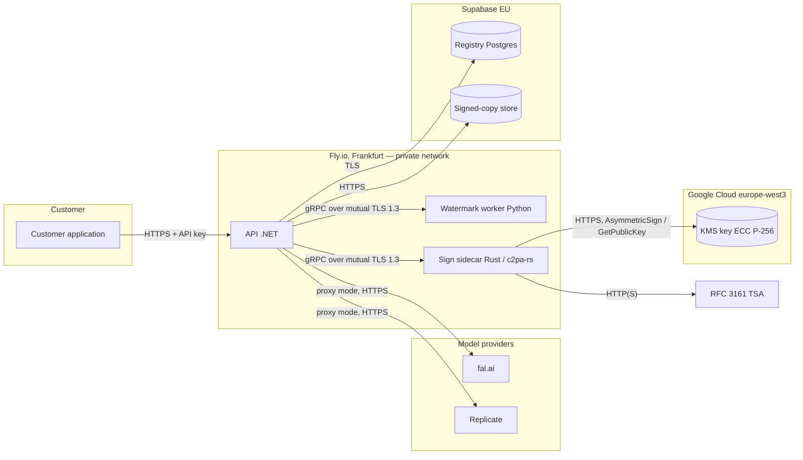

# C2PA Generator Product Security Architecture Document — SignUnder

> **DRAFT — not ready to submit.** Started 14 October 2026 on the program's template
> (`C2PA Generator Product Security Architecture Document Template.md`, Conformance Program
> v0.2, read from `c2pa-org/conformance-public` the same day). Every statement carries a
> status:
>
> - **[Built]** exists in this repository and has been run.
> - **[Planned]** is the production design (SIGNUNDER.md §4.9, ADR 0002, ADR 0004) and is
>   not yet deployed. It must be built and checked before this document is submitted.
> - **[Gap]** is required at Assurance Level 1 and neither built nor designed in detail.
> - **[Eoin]** needs information only the applicant can give.
>
> Remove this note, the status tags and the "Before submission" list when the document is
> final. The program requires Markdown, plus any diagrams as PNG or JPEG.

## Before submission

| # | Item | Objective | Status |
|---|---|---|---|
| 1 | Applicant's legal name, address and contact; certificate subject fields | §1.1, §1.4 | [Eoin] |
| 2 | Production deploy: API, sidecar and watermark worker on Fly.io (`fra`), registry on Supabase (EU), signing key in Google Cloud KMS (HSM, `europe-west3`) | O.2, O.5, O.6 | [Built on staging] 15 Oct 2026 (ADR 0012); production apps [Planned] |
| 3 | IAM: the sidecar's service account limited to signing with and reading the public key of SignUnder's key, reached from Fly.io by workload identity federation; human access time-bound | O.2, O.6 | Key and service account [Built] 15 Oct 2026 (checked: it can sign and read the public key; listing keys and destroying the version are refused); federation [Built on staging]: the staging sidecar signs with no stored credential |
| 4 | Mutual TLS 1.3 between the API and the sidecar, and between the API and the watermark worker | O.2, O.5 | [Built] locally and [Built on staging] with its own certificate set; production certificates [Planned] |
| 5 | A CSR tool that has the KMS sign the certificate request, so the key never leaves KMS | O.1, O.2 | [Built] (`kms-csr`); run against the HSM key 15 Oct 2026 (a test CA issued the staging certificate from it) |
| 6 | An OWASP Top 10 review or scan of the public API | O.6 | [Built] against the local stack (`owasp-review.md`); repeat against staging [Planned] |
| 7 | Written vulnerability-remediation procedure (30/90/180 days for hosting, 90 days for CRITICAL/HIGH in the claim generator) | O.3, O.4, O.6 | Process written below; [Gap] to adopt formally |
| 8 | Architecture diagram as PNG (the Mermaid source below renders it) | §1.6 | [Gap] |
| 9 | Sample files and `.crjson` signed by the production key | Sample evidence | [Planned]; local samples pass the program's rubric (`make conformance`) |

---

## 1. Generator Product Information

### 1.1 Applicant organization details

[Eoin] Full legal name, registered address, and contact name, email and telephone of the
applicant organisation. SIGNUNDER.md names AivaStack as the parent company; confirm it is
the applicant.

### 1.2 C2PA Conformance Program Version

0.2

### 1.3 C2PA Content Credentials Specification Version

2.4. Every manifest declares `specVersion: "2.4"` in `claim_generator_info`, as the
program's Additional Conformance Requirements v0.2 require. [Built]

### 1.4 Distinguished name

1. **Common Name (CN):** SignUnder
2. **Organization (O):** [Eoin] the applicant's registered legal name
3. **Organizational Unit (OU):** not used
4. **Country (C):** [Eoin] IE, if the applicant is registered in Ireland

### 1.5 Generator Product Description

SignUnder is a hosted service that marks AI-generated still images with C2PA Content
Credentials. A business sends an image it has generated, either directly to SignUnder's
API (`POST /v1/sign`) or by routing its fal.ai or Replicate calls through SignUnder's
proxy, which signs the images in the provider's result before returning them. For each
image SignUnder:

1. embeds an invisible watermark (TrustMark, model Q) carrying a 61-bit identifier and
   computes a perceptual fingerprint (PDQ);
2. builds a C2PA manifest: a `c2pa.actions.v2` assertion with `c2pa.created`
   (`digitalSourceType` `trainedAlgorithmicMedia`) and `c2pa.watermarked.bound`,
   `allActionsIncluded: true`, a `c2pa.soft-binding` assertion carrying the watermark
   identifier, and the hard binding (`c2pa.hash.data`);
3. signs the claim (ES256) with a key held in a hardware security module in Google Cloud
   KMS and adds an RFC 3161 timestamp;
4. validates the signed asset with the same library before releasing it, and refuses to
   release one that does not validate;
5. records hashes of the output and its manifest, never the image itself, in a registry.

**Use cases:** companies that generate images with open-weight or third-party models and
must mark them as AI-generated (EU AI Act Article 50(2)). **Audience:** developers at
those companies, through an HTTP API and a .NET SDK. **Key features:** watermark, manifest
and fingerprint together; a registry record per output; proxy mode for fal.ai and
Replicate.

This listing covers SignUnder's own signing. Customers that need to sign under their own
name apply for their own conformance; SignUnder's key signs only its own output.

### 1.6 Generator Product Target of Evaluation (GP TOE) Description

The TOE runs entirely in hosting environments (Backend class). It begins when an image
arrives at SignUnder (uploaded by a customer, or downloaded from fal.ai or Replicate media
hosts in proxy mode) and ends when the signed image is returned to the customer or stored
for them to fetch.

| Component | What it does | Software | Where it runs | Status |
|---|---|---|---|---|
| API | Authenticates customers (API keys), applies the pipeline, writes registry records, serves stored signed copies | .NET 10 (ASP.NET Core) | Fly.io, Frankfurt | Code [Built]; deploy [Planned] |
| Watermark worker | Embeds the TrustMark watermark; computes the PDQ fingerprint | Python 3.12, TrustMark 0.9.2, PyTorch (CPU), Pillow | Fly.io, Frankfurt | Code [Built]; deploy [Planned] |
| Sign sidecar (claim generator) | Builds the manifest, has KMS sign the claim, adds the timestamp, validates the result | Rust, c2pa-rs 0.91.2 (pinned exactly) | Fly.io, Frankfurt | Code [Built]; deploy [Planned] |
| Claim signing key | ECDSA P-256 key, HSM protection level; signs claims | Google Cloud KMS | Google Cloud `europe-west3` (Frankfurt) | Code path [Built]: tested against an emulator; the Cloud KMS path awaits a real key (`make test-gcp`); key [Planned] |
| Registry | Tenants, key references and certificate chains, records of outputs (hashes only) | PostgreSQL | Supabase, EU (Frankfurt) | Schema [Built]; deploy [Planned] |
| Signed-copy store | Signed outputs in proxy mode, kept up to 30 days | S3-compatible object storage | Supabase Storage, EU | Code [Built] against an S3 stand-in; deploy [Planned] |
| Timestamp authority | RFC 3161 timestamps | External (SSL.com, per the certificate bundle) | — | Client [Built] (tested with DigiCert's public TSA) |

Outside the TOE: customers' applications (which hold SignUnder API keys), fal.ai and
Replicate (sources of images in proxy mode), and the Certification Authority.

### 1.7 Implementation Class

Backend

### 1.8 Target Max Assurance Level

Assurance Level 1

### 1.9 Target Generator Product capabilities

1. Claim generation: `image/jpeg`, `image/png`, `image/webp`
2. Claim validation: none. (SignUnder validates its own output before release, and its
   `/v1/verify` endpoint reports on any image, but it does not take incoming manifests as
   ingredients, so no validate media types are claimed.)

---

## 2. Security Architecture Details by Objective

### 2.1 [O.1] Automated Certificate Enrollment Proof of Eligibility (§6.1)

#### 2.1.1 Assurance Level 1 & 2 Base Evidence (Enrollment Process & Secret Management)

The O.1 requirements apply to automated enrollment. SignUnder does not enroll
automatically: it holds one claim signing key and renews its certificate once a year by
hand.

1. **Certificate Enrollment Process.** [Planned] After the Notice of Conformance, an
   operator creates the KMS key (§2.2), produces a certificate signing request whose
   signature is made by KMS, and submits it through the Certification
   Authority's portal (SSL.com) with the CPL record id. The request tool is `kms-csr` (in `src/sign-sidecar`)
   [Built]: it reads the public key from KMS, has KMS sign the request (`Sign`, digest
   mode), and writes the extensions the program's claim-signing AL1 request profile asks
   for (subject C, O, CN; basic constraints critical and not a CA; key usage critical,
   digitalSignature and contentCommitment; extended key usage C2PA claim signing and email
   protection; the C2PA certificate policy; assurance level AL1; the CPL record id).
   Tested against the local-kms emulator: openssl verifies the request's signature and the
   request carries the KMS key's public key. The issued chain is stored as the
   key's `cert_chain_pem` in the registry (`tenant_key`) and the key is marked active.
   Before every signature the sidecar checks that the certificate's public key equals the
   KMS key's public key (`GetPublicKey`, cached) and refuses to sign otherwise [Built,
   tested]. Renewal starts at day 330 of the 366-day validity.
2. **Authentication Method & API Details.** Not automated. Enrollment is authenticated
   by the operator's account with the CA, protected by multi-factor authentication
   [Planned].
3. **Management of Authentication Secrets.** No enrollment secret is stored in the
   product. The CA account credentials belong to named people and live in their password
   managers [Planned].

#### 2.1.2 Assurance Level 2 Additional Evidence

Not applicable (Assurance Level 1).

---

### 2.2 [O.2] Confidentiality of the Claim Signing Key (§6.2)

#### 2.2.1 Assurance Level 1 & 2 Base Evidence (Key Generation, Least Privilege & Rotation)

1. **Key Generation & Storage.** [Built 15 October 2026: `claim-signing` version 1 in key
   ring `signunder`, `europe-west3`, generated 06:50:58 UTC; its HSM attestation, the
   Cavium and Google certificate chains and the public key are in
   `evidence/cloud-kms-claim-signing-v1/`] The key is generated inside Google Cloud KMS,
   in a project used only for SignUnder, key ring in `europe-west3` (Frankfurt), as an
   `EC_SIGN_P256_SHA256` key with purpose `ASYMMETRIC_SIGN` and protection level **HSM**.
   Claims are signed with ES256 (ECDSA P-256 with SHA-256), which NIST (FIPS 186-5) and
   the ENISA Agreed Cryptographic Mechanisms list. HSM key versions are always stored in a
   hardware security module and are not extractable; Google provides an attestation,
   signed by Google's and the HSM manufacturer's certificate chains, that the key was
   created in an HSM (Cloud KMS documentation, read 15 October 2026). The sidecar computes
   the SHA-256 digest of the data to be signed and calls `AsymmetricSign` with that digest
   [Built: the shared KMS code is tested against an emulator; the Cloud KMS call awaits a
   real key, `make test-gcp`; ADR 0004, ADR 0011].
2. **Access Controls & Encryption.** [Built for the key; federation Planned] Only the
   sidecar's service account (`signunder-signer`) may use the key, through IAM roles granted on that one key, not the project:
   `roles/cloudkms.signerVerifier` and `roles/cloudkms.publicKeyViewer`. No application
   principal can export the key (HSM keys are not extractable), destroy versions or change
   IAM. Key administration (creating versions, disabling, scheduling destruction, IAM)
   belongs to named people's accounts with multi-factor authentication. Cloud Audit Logs
   record administrative actions; data-access logging for key use is to be enabled on the
   key's project. The sidecar on Fly.io reaches the service account by workload identity
   federation trusting Fly.io's OpenID Connect issuer for SignUnder's organisation and app,
   so no credential is stored [Built on staging 15 Oct 2026: Fly.io's machine token from
   `/.fly/oidc_token` is exchanged at workload identity pool `fly-io`, which trusts only
   issuer `https://oidc.fly.io/eoin-butler` for apps named `signunder-*`; only the sidecar
   app may act as the signer; ADR 0011, ADR 0012].
3. **Ephemeral Plaintext Key Handling.** Not applicable: the plaintext private key is
   never present outside KMS.
4. **Key Rotation Process.** [Built in the data model; Planned operationally] Rotation
   creates a new key version in Cloud KMS and enrolls a new certificate for it (§2.1.1), stores it as a new
   `tenant_key` marked active and marks the previous one retired. The sidecar always signs
   with the active key. Retired versions are disabled in Cloud KMS but not destroyed, so that past manifests
   remain checkable against their certificate's validity period. Triggers: certificate
   renewal (yearly), suspected compromise (immediately: revoke the certificate, disable
   the key, notify the CA, record the incident), or a change in the program's algorithm
   requirements.
5. **Subsystem Mutual Authentication & Role Validation.**
   - *Customer application to API:* each request carries a SignUnder API key
     (`Authorization: Bearer su_live_…`, or `X-SignUnder-Key` in proxy mode). Keys are 256
     random bits, stored only as SHA-256, scoped (`sign`, `verify`, `records:read`) and
     revocable. The API key only limits access to the backend; it plays no part in signing
     [Built; ADR 0006].
   - *API to sidecar and API to watermark worker:* mutual TLS with certificates from a
     private CA used for nothing else (ADR 0010) [Built; on staging with its own set,
     held as Fly secrets; production certificates Planned].
     Each server presents a certificate for its own name (`sign-sidecar`, `wm-worker`) and
     requires a client certificate from the CA; it then accepts only a certificate naming
     `signunder-api` and refuses any other with `PERMISSION_DENIED`, so the role of each
     side is authenticated by the other. The API accepts only a server certificate that
     chains to the CA and matches the host it connected to. Tested: plain-text calls,
     calls without a client certificate, and calls with a valid certificate for another
     name are all refused.
   - *Sidecar to Google Cloud KMS:* OAuth 2.0 access tokens over TLS, from the federated
     credentials above [Built on staging].

#### 2.2.2 and 2.2.3 Assurance Level 2 Additional Evidence

Not applicable (Assurance Level 1).

---

### 2.3 [O.3] Protection of the Claim Generator (§6.3)

#### 2.3.1 Assurance Level 1 & 2 Base Evidence (SCA/SBOM Scan Tools & 90-Day Remediation Policy)

1. **SCA / SBOM Scanning Tools.** [Built] Trivy (pinned at 0.74.0), whose vulnerability
   database draws on the NIST NVD and on language and distribution advisories, scans:
   - the claim generator's dependency lockfile (`src/sign-sidecar/Cargo.lock`, including
     c2pa-rs and its cryptography crates) on every push, every pull request and daily
     (`.github/workflows/security.yml`);
   - the sidecar's container image, daily and whenever its inputs change
     (`.github/workflows/images.yml`).

   Each run publishes a CycloneDX SBOM. The runtime image is distroless (glibc, libgcc and
   CA certificates only), so the operating-system surface is minimal.
2. **90-Day Remediation Policy.** [Built] The lockfile scan fails the build on any
   CRITICAL or HIGH finding. The image scan fails on any CRITICAL or HIGH finding that has
   a fix and reports those without one. A failing scan blocks merging and release. A
   finding can be deferred only by an entry in `.trivyignore.yaml` with a written reason
   and an expiry date; `tools/security/check-ignores.py` fails the build if any expiry is
   more than 90 days away, so no finding can be released more than 90 days after it is
   accepted. Evidence of the mechanism working (14 October 2026): the first scan found
   GHSA-82j2-j2ch-gfr8 (HIGH) in `rustls-webpki` 0.101.7 and it was removed the same day
   by moving the AWS SDK to its current HTTPS client.

#### 2.3.2 Assurance Level 2 Additional Evidence

Not applicable (Assurance Level 1).

---

### 2.4 [O.4] Protection of Assets & Assertions at Generation (§6.4)

#### 2.4.1 Assurance Level 1 & 2 Base Evidence (SCA/SBOM Scan Tools & Remediation for Content Software)

1. **SCA / SBOM Scanning Tools.** [Built] The same scans (§2.3.1) cover all software that
   processes images or assertions:
   - the watermark worker's lockfile (`src/wm-worker/uv.lock`: TrustMark, PyTorch, Pillow,
     NumPy, pdqhash) and its image (Debian 13 slim, with OS updates applied at build);
   - the API's NuGet lockfiles and its image (Microsoft's ASP.NET Core image);
   - the sidecar, as in §2.3.1.
2. **90-Day Remediation Policy.** [Built] As in §2.3.1.

At the date of drafting the image scans showed no CRITICAL or HIGH finding with a fix
available. Unfixed HIGH findings remain in base operating-system packages that the
services do not use (for example `util-linux` and `ncurses` in the worker image); they are
tracked by the daily scan and will be picked up by the next rebuild once fixed.

#### 2.4.2 Assurance Level 2 Additional Evidence

Not applicable (Assurance Level 1).

---

### 2.5 [O.5] Protection of Traffic Between Subsystems (§6.5)

#### 2.5.1 Assurance Level 1 & 2 Base Evidence for Distributed & Backend Classes (TLS 1.3 & Cryptographic Protocols)

1. **TLS 1.3 & Cryptographic Protocols.**

   | Channel | Protection | Status |
   |---|---|---|
   | Customer application → API | HTTPS terminated at Fly.io's edge, which accepts TLS 1.3 and 1.2 (checked 15 Oct 2026; Let's Encrypt certificate). Customer applications are outside the TOE | [Built on staging] |
   | API → watermark worker, API → sidecar | gRPC over mutual TLS (private CA), inside Fly.io's private network (WireGuard-based, *from memory*, UNVERIFIED). The API offers only TLS 1.3, so every connection it makes is TLS 1.3 (checked: both services negotiate TLSv1.3). The servers would also accept TLS 1.2 from a client holding the API's certificate: neither tonic's nor Python gRPC's server settings expose a minimum version | [Built] locally; production certificates [Planned] |
   | Sidecar → Google Cloud KMS | HTTPS with OAuth 2.0 tokens (Google's client library; TLS version negotiated with Google's front end, TLS 1.3 *from memory*, UNVERIFIED) | [Planned] |
   | API → fal.ai / Replicate, downloads from their media hosts | HTTPS only; hosts on an allowlist; no redirects | [Built] |
   | API → Supabase Postgres and Storage | TLS (`SSL Mode=Require` through Supabase's session pooler; HTTPS for Storage) | [Built on staging] |
   | Sidecar → timestamp authority | RFC 3161 over HTTP or HTTPS; the response is signed by the TSA and checked on validation | [Built] |

---

### 2.6 [O.6] Protection of the Hosting Environment (§6.6)

#### 2.6.1 Assurance Level 1 & 2 Base Evidence for Distributed & Backend Classes (IAM, RBAC, Cloud Resource Policies & OWASP Top 10)

1. **IAM & Role-Based Access Control.** [Planned] Three IAM systems cover the hosting
   environment:
   - Google Cloud IAM for the KMS key and its service account (§2.2.1);
   - Fly.io organisation roles and scoped deploy tokens for the application machines;
   - Supabase organisation roles for the database and storage, with Postgres roles and
     row-level security for tenant isolation (SIGNUNDER.md §4.10).
2. **Principal Access Policies.** [Planned]
   - *Non-human:* the CI deployer holds a Fly.io deploy token scoped to the SignUnder
     apps. The sidecar's service account may only sign
     with and read the public key of one key. The API connects to Postgres as a
     role subject to row-level security, never the service role, on tenant paths.
   - *Human:* named accounts with MFA on GitHub, Fly.io, Supabase, Google Cloud and the
     CA; no shared accounts.
3. **Cloud Resource IAM Policies.** [Planned]
   - KMS key: key policy as in §2.2.1.
   - Storage bucket for signed copies: private; written by the API only; objects expire
     after 30 days (ADR 0008).
   - Database: reachable only with credentials held as Fly.io secrets.
4. **Vulnerability Scanning & OWASP Top 10 Coverage.**
   - Dependencies and images: as in §2.3.1 [Built].
   - API surface: an OWASP Top 10:2025 review of every public endpoint, with an OWASP ZAP
     2.17.0 API scan driven by the API's OpenAPI description, is in
     `docs/conformance/owasp-review.md` (14 October 2026) [Built against the local stack;
     repeat against staging Planned]. It found and fixed six issues: internal error
     details reaching callers, missing security headers, cacheable authenticated
     responses, no rate limiting, unlogged API-key refusals, and undefined handling of
     unhandled exceptions. After the fixes ZAP reports 119 checks passed, no warnings and
     no failures (`docs/conformance/evidence/zap-api-scan-2026-10-14.html`).
5. **Timely Remediation Policy.** Hosting-environment vulnerabilities are fixed within 30
   days (high), 90 days (moderate) and 180 days (low) of detection, by CVSS severity.
   Detection is the daily scans plus provider security notices (Fly.io, Supabase, Google Cloud).
   Images are rebuilt at least monthly and whenever a scan finds a fixable issue, which
   also applies operating-system updates. [Written here; Gap: adopt and assign an owner.]

Basic exploit countermeasures: the services are written in memory-safe languages (Rust,
C#, Python) and run as non-root users in containers on Linux, whose kernel provides ASLR
and non-executable memory (NX) [Built in the images; hosting Planned].

#### 2.6.2 Assurance Level 2 Additional Evidence

Not applicable (Assurance Level 1).
